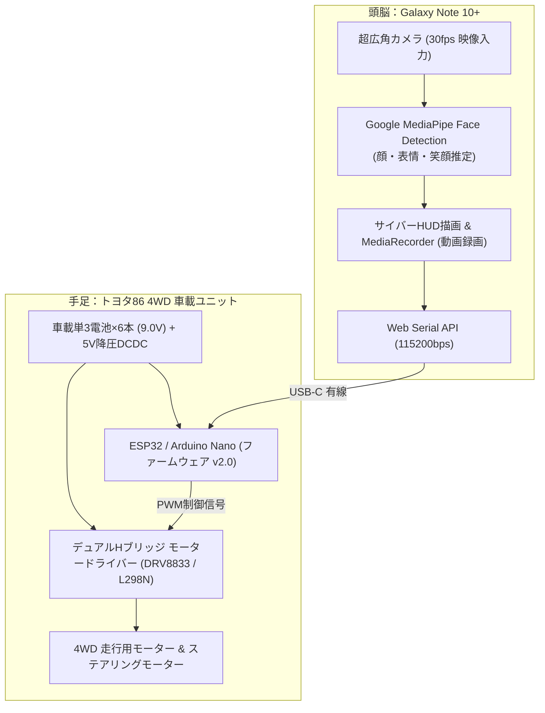

# Phone-as-a-Brain: Toyota 86 Emotional Autonomous Vehicle

市販のトイラジコン（ジョーゼン 1/16スケール トヨタ86 4WD）に、スマートフォン（Galaxy Note 10+）を搭載し、スマートフォンの演算能力（CPU/GPU/NPU）、カメラ、通信機能を「頭脳」として活用した超低コスト自律走行ロボットプラットフォームです。

UCLA RoMeLa（*PhoneBot*）および UC Berkeley BAIR（*OpenBot*）の「Phone-as-a-Brain」アーキテクチャの設計思想を取り入れています。

---

## 1. 特徴 (Features)
- **圧倒的な低コスト（追加ハード 約1,500円〜2,000円）**:
  高価な専用基板やLiDARを自作・購入せず、すでに成熟したスマートフォンのセンサーと演算能力を活用。
- **4WD（四輪駆動）ベース**:
  ジョーゼン JRVC015-RD（単3電池×6本＝9.0V駆動）の頑丈な4WDシャーシを採用。スマホ（約196g）を載せても力強く走行。
- **Google MediaPipeによるリアルタイム感情・表情認識**:
  エッジブラウザ上で顔検出・表情（笑顔・集中）を完全ローカル推論。人が笑顔を見せると嬉しそうに駆け寄るエモーショナル追従走行を実装。
- **テスラ/FSD風サイバーHUD ＆ ワンタップSNS動画録画 (REC)**:
  速度計、操舵角、ターゲットロックオン枠、パースペクティブ道路グリッドを30fpsでリアルタイム描画。ワンタップでスマホ内に合成動画（.webm）を録画保存可能。
- **フェイルセーフ機能 (v2.0 ファームウェア)**:
  通信が400ms途切れた際の自動緊急ブレーキ、急加速・スリップを防ぐスムーズ加減速（Slew Rate Limiting）を搭載。

---

## 2. システム構成 (System Architecture)



---

## 3. ディレクトリ構成 (Repository Structure)

```text
phone-robot/
├── docs/
│   └── toyota86_autonomous_design.md   # ハードウェア詳細設計書・配線ピンアサイン
├── firmware/
│   └── esp32_toyota86/
│       └── esp32_toyota86.ino          # 車載マイコン用ファームウェア (Watchdog・スムージング付き)
├── web/
│   └── index.html                      # スマホ側 自律運転サイバーHUDコントローラー (Web Serial / MediaPipe)
├── index.html                          # ルート配信用 (GitHub Pages等ですぐ開ける)
└── README.md
```

---

## 4. 必要部品 (Bill of Materials)

| 部品名 | 推奨型番 | 用途 | 参考価格 |
|---|---|---|---|
| 車体本体 | ジョーゼン JRVC015-RD (1/16 トヨタ86 4WD) | ベース車両 | 手持ち品 |
| スマートフォン | Galaxy Note 10+ (RAM 12GB / Snapdragon 855) | メイン頭脳・カメラ・HUD表示 | 手持ち品 |
| マイコン | ESP32 Type-C 開発ボード または Arduino Nano | 車載制御 | 約900〜1,200円 |
| モータードライバー | DRV8833 または L298N Mini | モーター駆動 | 約300〜500円 |
| 降圧モジュール | AMS1117 5V | 9V電池からマイコン用5V生成 | 約200円 |
| 配線 | ジャンパーワイヤー・USB-C OTG変換アダプタ | 結線・有線直結 | 約300円 |

---

## 5. 動かし方 (Getting Started)

1. **車体の配線**:
   `docs/toyota86_autonomous_design.md` を参照し、ラジコンのモーターとモータードライバー、マイコンを配線。
2. **ファームウェア書き込み**:
   Arduino IDEで `firmware/esp32_toyota86/esp32_toyota86.ino` をマイコンに書き込む。
3. **スマホ搭載**:
   Galaxy Note 10+ を車体に養生テープ等で固定し、USB-Cケーブルでマイコンと繋ぐ。
4. **Webコントローラー起動**:
   スマホのChrome/Braveで `web/index.html` を開く。
5. **走行**:
   「⚡ USB CONNECT」を押して接続 → 「▶ AUTO」を押すと自律追従がスタートします。
