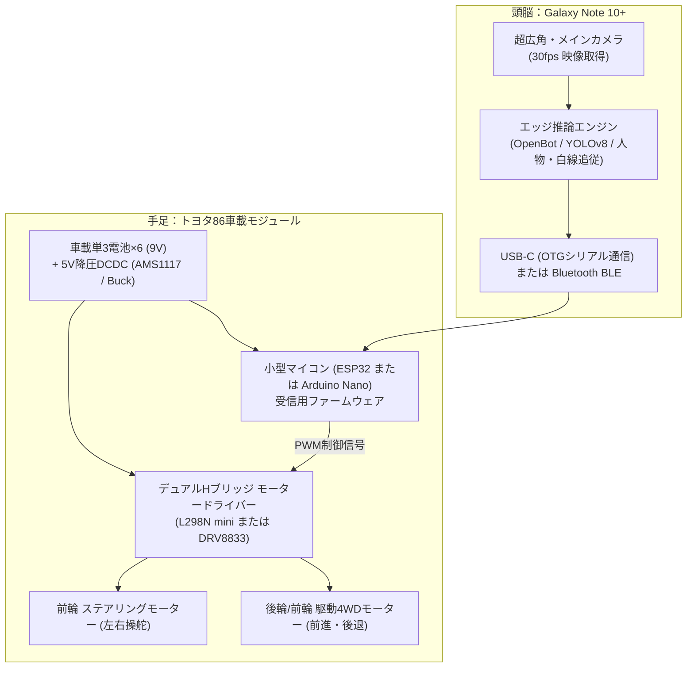

# ジョーゼン 1/16 トヨタ86（JRVC015-RD）スマホ自動運転化 設計仕様書

## 1. ベース車両の仕様（JRVC015-RD）
- **メーカー・製品名**: 株式会社ジョーゼン ダートマックス 1/16スケール トヨタ86 ドリフトドライブ
- **スケール・寸法**: 1/16（全長約260mm × 幅約110mm × 高さ約80mm）
  - Galaxy Note 10+（長さ162mm × 幅77mm）をルーフまたはボンネットに載せるのに最適なサイズ感。
- **駆動方式**: 4輪駆動（4WD）＋ 独立フロントステアリング
  - 4WDのためトルクが太く、スマホ（約196g）を載せても走行性能が落ちない。
- **電源**:
  - 車体本体：**単3形アルカリ乾電池 × 6本（公称 9.0V / エネループ等充電池で 7.2V）**
  - コントローラー：9V角形乾電池（自律運転時は車載マイコン化するためコントローラーは不要）
- **最高速度**: 約10〜11km/h

---

## 2. システム構成とハードウェア接続

### ① 全体ブロック図

---

## 3. 必要部品と総コスト（約1,500円〜2,500円）

すべてAmazonや秋月電子、AliExpressで即日〜数日で揃う安価な汎用部品です。

| 部品名 | 推奨型番 | 用途 | 参考価格 |
|---|---|---|---|
| **マイコンボード** | **ESP32 NodeMCU** または **Arduino Nano Type-C** | スマホからの命令を受信しモーターを制御 | 約800〜1,200円 |
| **モータードライバー** | **DRV8833** または **L298N Mini** | 9V電源から走行用・操舵用モーターを駆動 | 約300〜500円 |
| **降圧モジュール** | **AMS1117 5V** または 小型DCDCコンバータ | 車載9V電池からマイコン用の安定化5Vを生成 | 約200円 |
| **配線・コネクタ** | ジャンパーワイヤー・USB-C OTG変換アダプタ | スマホとマイコンの有線接続 | 約300円 |
| **合計コスト** | - | - | **約1,600円〜2,200円** |

---

## 4. 車体側の配線手順（改造ステップ）

1. **ボディの取り外し**:
   - 車体裏側のネジを外し、トヨタ86のプラスチックボディをシャーシから外す。
2. **既存基板のバイパス**:
   - 車体中央にある既存のトイラジコン基板から出ている**モーター線（前後の走行用モーター2本、左右のステアリングモーター2本）**を外す。
3. **モータードライバー（DRV8833/L298N）との結線**:
   - `OUT1`, `OUT2` → 走行用4WDモーター（前進・後退）
   - `OUT3`, `OUT4` → ステアリングモーター（左・右）
   - `VCC` → 電池ボックスのプラス（9V）
   - `GND` → 電池ボックスのマイナス
4. **マイコン（ESP32/Arduino）との結線**:
   - `IN1`, `IN2`（走行PWM） → マイコンの D5, D6 ピン
   - `IN3`, `IN4`（操舵PWM） → マイコンの D9, D10 ピン
   - `VIN` → 降圧5V
   - `GND` → 共通GND
5. **スマホの固定**:
   - ルーフ（屋根）またはボンネット上に、段ボールまたはスポンジを挟んで養生テープ/結束バンドで固定。
   - USB-Cケーブルでスマホとマイコンを直結。
